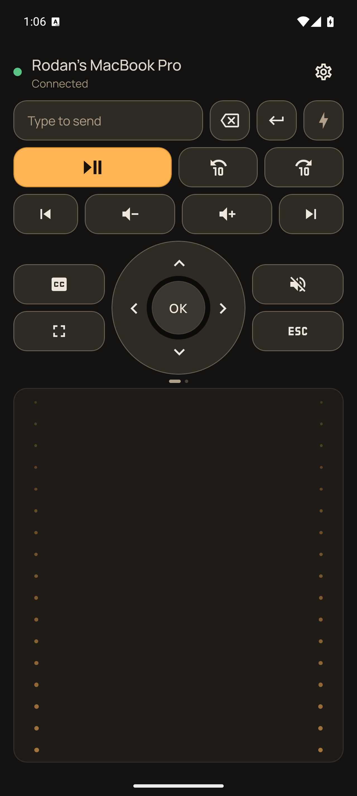
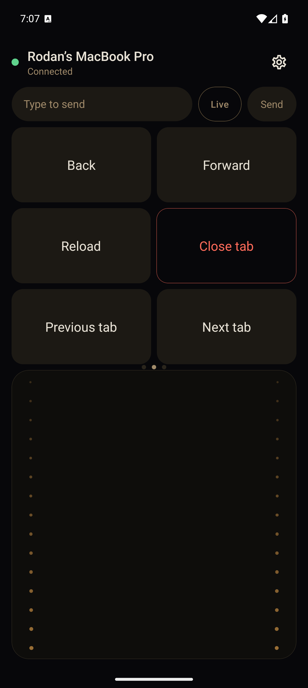
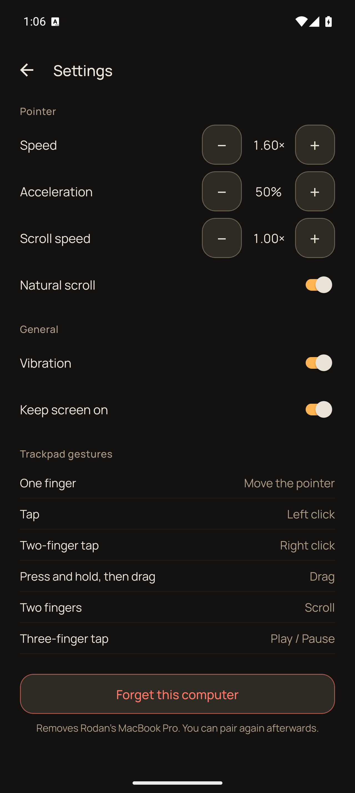
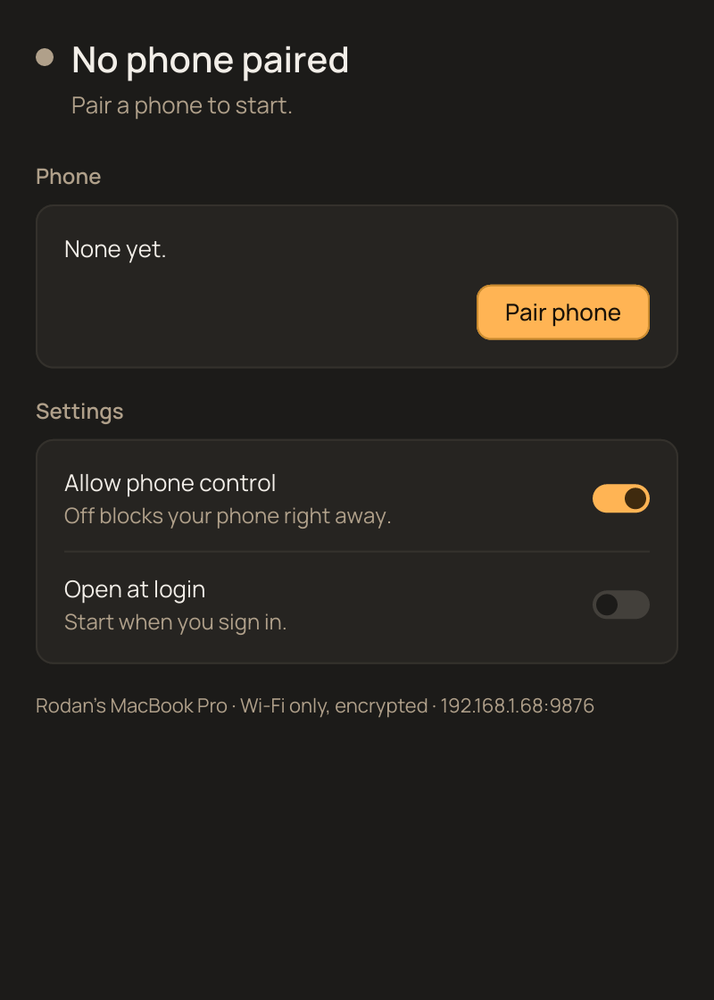
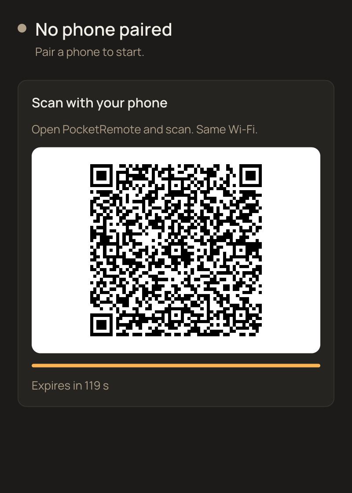
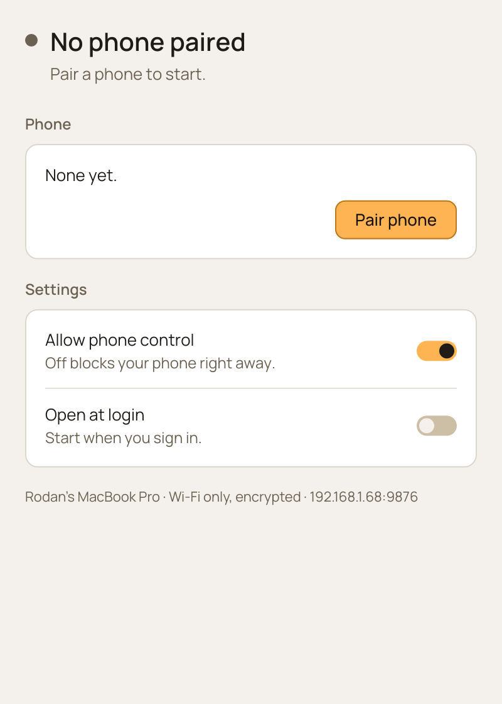

<div align="center">

# PocketRemote

**Your phone as a remote for your computer.** Trackpad, keyboard, media keys, D-pad and browser keys over your own Wi-Fi.
Free, no account, no cloud. Every session is end-to-end encrypted and approved on the computer.

[](https://github.com/rodanr/PocketRemote/actions/workflows/ci.yml)
`license: Apache-2.0` · `version: 1.0.5` · `platforms: Android phone, macOS host (Windows/Linux planned)`





<br/>





<sub>Top: the phone app. Bottom: the Mac Control Panel (follows the system light/dark setting).</sub>

</div>

## What it does

- **Trackpad** with tap, two-finger right-click, scroll, hold-and-drag and a three-finger Play/Pause shortcut.
- **Remote page**: Play/Pause, seek, volume, previous/next track, captions, fullscreen, Esc, mute and a D-pad.
- **Browser and slides page**: back, forward, reload, tab keys, close tab, previous/next slide.
- **Typing bar**: type a message and send it, or switch on Live typing; Backspace and Enter always act on the computer.
- **Mac menu-bar app** with a Control Panel: pairing QR, approve with a matching code, pause, disconnect, remove phone, launch at login, and a native macOS notification (with the app icon) when a phone asks to connect.

## How it works

```
Phone app  ──  Noise-encrypted session over your Wi-Fi  ──>  Mac host  ──>  keyboard / mouse / media keys
 (Expo)         (pinned keys, approved on the computer)       (Rust)
```

No server in the middle: the phone talks straight to your computer. See [docs/ARCHITECTURE.md](docs/ARCHITECTURE.md).

## Install

**Mac (Homebrew, Apple silicon, macOS 12+):**

```sh
brew install --cask rodanr/tap/pocketremote
```

**Android phone:** download `PocketRemote-X.Y.Z.apk` from the [Releases page](https://github.com/rodanr/PocketRemote/releases/latest) and sideload it.
Without Homebrew, the Mac `.dmg` is on the same page. Checksums, updating and uninstalling: [docs/INSTALL.md](docs/INSTALL.md).

## Security in one paragraph

A session gives full control of a desktop, so security comes first. Pairing uses a one-time QR token, a Noise `XXpsk3`
handshake and a matching 6-digit code that you **approve on the computer**. After that every session is a Noise `KK`
handshake between pinned keys. Exactly one phone is paired at a time; the host never listens on all interfaces; a new
network starts paused until you allow it. There are no commands for shells, files, URLs or the clipboard.
Details: [docs/security.md](docs/security.md) and [SECURITY.md](SECURITY.md).

## Quick start (development)

```sh
# Mac host (menu-bar app + Control Panel)
cd desktop && cargo run --features gui --bin pocketremote-host

# Phone app (runs in Expo Go, no native build needed)
cd app && npm install && npx expo start
```

Scan the QR in the Control Panel with the phone app, compare the code, press **Approve** on the computer.
Full setup, test commands and the emulator recipe are in [docs/DEVELOPMENT.md](docs/DEVELOPMENT.md).
Installing a built copy: [docs/INSTALL.md](docs/INSTALL.md).

## Repository map

| Path | What is in it |
|---|---|
| `desktop/` | Rust host: protocol, Noise, pairing, server, executor, input backends, terminal host, GUI host (`--features gui`) |
| `app/` | Expo / React Native phone app (TypeScript): Noise client, session, connection, trackpad gestures, UI |
| `protocol/` | Wire-protocol fixtures and Noise test vectors shared by Rust and TypeScript |
| `brand/` | Logo kit, app and tray icons, generation scripts |
| `docs/` | Architecture, development, install, security, design brief, decisions |
| `scripts/` | Packaging scripts (`build-macos.sh`) |
| `PLAN.md` | The normative spec and phase plan |
| `AGENTS.md`, `CLAUDE.md` | Instructions for AI coding agents |

## Documentation

Start at [docs/README.md](docs/README.md). Highlights:
[Architecture](docs/ARCHITECTURE.md) · [Development](docs/DEVELOPMENT.md) · [Install](docs/INSTALL.md) ·
[Security](docs/security.md) · [Design brief](docs/design-brief.md) · [Decisions](docs/DECISIONS.md) · [Changelog](CHANGELOG.md).

## Contributing

See [CONTRIBUTING.md](CONTRIBUTING.md). Security-sensitive files need the owner's review (see `.github/CODEOWNERS`).
AI agents: read [AGENTS.md](AGENTS.md) first.

## License

[Apache-2.0](LICENSE). Third-party material (the Manrope typeface and others) is listed in [NOTICE](NOTICE). The name "PocketRemote" and the logo are not licensed for reuse.
