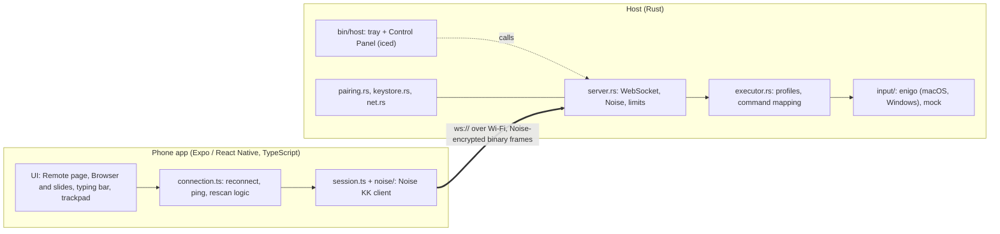

# Architecture

PocketRemote has two programs that talk over the local network:

## Protocol (`desktop/src/protocol.rs` is the source of truth)

- WebSocket binary frames. First frame `[kind][version][noise message]`, then encrypted JSON messages (about 15 types:
  `move`, `click`, `scroll`, `key`, `text`, `media`, `player`, `browser`, `ping`, `status`, `error`, `paired`, ...).
- Limits (all enforced in `server.rs`): 4096-byte frames, 500-character text, 250 messages per second, idle and silence timeouts.
- `app/src/protocol.ts` is **generated** from the Rust types (ts-rs). Fixtures in `protocol/fixtures/` are loaded by both test suites.

## Pairing and sessions

1. The host shows a QR (`pocketremote://` URI with a one-time token, expiring in seconds).
2. The phone connects and runs a Noise `XXpsk3` handshake using that token. Both screens show the same 6-digit code.
3. The user presses **Approve** on the computer. Each side stores the other's static public key (host: OS keychain; phone: secure store).
4. Later sessions use Noise `KK` between those pinned keys. A new pairing revokes the previous phone.

## Host modules

| Module | Role |
|---|---|
| `noise.rs`, `pairing.rs`, `keystore.rs`, `net.rs`, `server.rs` | Security-sensitive core (owner review required) |
| `executor.rs`, `input/` | Maps messages to input events through the `InputBackend` trait (`enigo` on macOS and Windows, `MockBackend` in tests) |
| `main.rs` | Terminal host for development (`--file-keys`, `--print-uri`, `--dry-run`) |
| `bin/host/` | GUI host (feature `gui`): `engine.rs` starts the server and caches secrets in memory, `tray.rs` menu-bar icon, `main.rs` Control Panel, `login.rs` launch at login |

## Phone modules

| Path | Role |
|---|---|
| `src/noise/`, `src/session.ts` | Noise client and protocol session (plain TypeScript, no React Native imports; security-sensitive) |
| `src/connection.ts` | Reconnect with backoff, ping, silence detection, and the "Scan again" decision (a stale pairing is detected after two failed handshakes) |
| `src/useRemote.ts` | React hook exposing state and `send` |
| `src/trackpad/`, `src/ui/Trackpad.tsx` | Pure-TS gesture recognizer and the aisle-light trackpad |
| `src/ui/` | Screens: `MainPage`, `MorePage` (Browser and slides), `Pager`, `KeyboardBar`, `SettingsScreen`, `ConnectionDialog`, `PairingScreen` |

## Why these choices

See [DECISIONS.md](DECISIONS.md). Threat model: [security.md](security.md).
